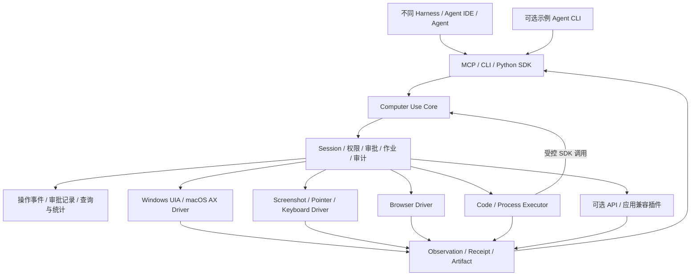

# Bokkio 新定位与改进计划

日期：2026-10-11。状态：核心实现与 macOS 开发验收已交付，工作候选版 0.2.0；完整客户验收尚未完成。跨环境接续以 [共享进度](progress/README.md) 为入口，实际验收见 [交付状态](RUNTIME-DELIVERY.md)。

执行调整（用户 2026-10-11 指示）：本机聚焦 macOS，Windows 新版本实机验收可在另一台 Windows 电脑继续。此前 VM 私有凭据已找回并验证登录，登录不再是阻塞。以下保留原三天双平台交付目标与门槛，未验收项不标记完成。

2026-10-12 续测记录：完成真实进程故障、MCP manifest 和 Numbers 无 Core 业务规则样本；桌面/作业矩阵 16/18，环境与客户输入缺口保留，详见 [共享状态](progress/STATUS.md)。

交付时限：**客户给定三天，作为硬约束。** Windows/macOS 双平台、通用工具调用、生成代码/脚本、可观察与可统计的操作日志、可追溯的操作及审批记录，均须进入三天交付版本。

实施原则：从已有 Bokkio 能力直接封装交付，使用 AI 编码生成适配层、日志/审批模块、客户端与验收脚本，并持续实机反馈。验收随实现进行；底座替换、目录重构和扩展研究按是否影响三天交付决定。第 8 节是执行排程，第 9 节是客户验收清单。

定位分析依据：附件 `/Users/andrewyeoh/Downloads/plan.md`、计划编写时的代码快照 `0d0ce0e`、项目验收报告及官方开源资料。后续实施复用了现有 Native Driver、官方 MCP SDK 与 Playwright；选型比较的其他候选未做性能实测，历史验收事实保留。

## 1. 建议的产品定位

**Bokkio 是面向企业的通用 Computer Use Runtime：让不同 Harness、Agent IDE 和 Agent，通过稳定的工具接口，在获准的电脑与资源上观察、执行代码或操作应用，并获得可核验的执行证据。**

它的主要交付物是本地执行组件、MCP Server、CLI 和代码 SDK。自然语言 CLI 可以作为可选示例客户端，供没有现成 Agent 的企业使用；模型、任务规划和聊天界面属于调用方或这个可选客户端。

三天交付版本支持 **Windows 和 macOS**，两端共享工具协议、权限模型、操作日志与审批记录，分别通过实机验收。每项操作都应能实时观察、汇总统计，并追溯到请求、调用身份、授权依据、执行事实和结果证据。

用户买到的价值应是：已有的 Agent 能接入真实电脑；一次授权适用于所允许的执行能力；换一个 Agent 不必重做桌面驱动、执行证据与企业配置。价值不能建立在持续补齐每个软件的操作配方上。

附件中“执行通道可组合”“安全独立”“Harness 可替换”的方向应保留。但其主架构仍从自然语言 CLI 和 AgentRuntime 出发。按照这次明确的目标，稳定边界应进一步下移到 **Computer Use 工具协议**。DeepSeek 仍是候选；CLI-only 和禁止安装第三方 AI 客户端是特定企业部署条件。三天时限已由用户明确为硬约束，所有选型与验收按此执行。

**核心成功问题：新 Agent 接入后，面对一个没有专门操作规则的应用，能否发现可用能力、采取动作、检查结果，并在无法确认时准确停下。**

## 2. 对当前项目的判断

当前困难不是动作数量太少，而是底层执行、模型决策、业务知识和验收逻辑逐渐混在一起。只更换 Harness，不能自动消除这些耦合。

### 2.1 已有资产与需要调整的边界

| 当前资产 | 我的判断 | 后续处理 |
|---|---|---|
| UIA/AX、统一元素、Selector、ref、窗口过滤 | 属于通用执行基础，已经积累了真实验证 | 保留，包装成无需模型的 Native Driver |
| 窗口/进程/文档身份、截图绑定、坐标映射、输入后读回 | 是容易被简单鼠标工具忽略的工程价值 | 抽出共同的执行前检查和 ActionReceipt |
| Planner + Jev 两层模型循环 | 曾帮助验证原生路径，但使所有任务受固定决策结构限制 | 迁到可选客户端；核心直接接受调用方动作；Jev 为可选定位辅助 |
| Word 选区、Styles 恢复、菜单意图规范化 | 部分是业务经验，部分是通用控件问题，不能全部留在 Planner 核心 | 分拆为上层 Skill、可选兼容插件、通用 Driver 修复 |
| Office 输入 transport、PPT 固定标签 | 有真实应用行为证据，但覆盖范围明确有限 | 保留有范围声明的插件；把通用点击/字段提交能力独立出来 |
| Workflow / Recorder / 恢复 | 对重复任务有价值，但不应成为新任务执行的前提 | 保留为可选配方与证据消费层；重放仍经过相同授权入口 |
| 独立产物检查、失败记录、实机 fixtures | 是可继续使用的评测资产 | 与产品执行代码分离，扩展未知应用与多调用方测试 |

例如，[planner.py](../src/bokkio/planner.py) 的 `normalize_word_targets`、`retain_pending_style` 已明确识别 Microsoft Word，并围绕正文、标题和样式修订计划；[office_visual.py](../src/bokkio/office_visual.py) 的 `OfficeVisualBackend` 声明了固定 PPT 输入标签。它们说明业务规则正在进入执行主路径。与此同时，[xa11y_backend.py](../src/bokkio/xa11y_backend.py)、[visual_input.py](../src/bokkio/visual_input.py) 的身份与派发检查值得继续复用。

安全检查也需要下移：[agent.py](../src/bokkio/agent.py) 目前根据子任务风险和 Send/Delete 等名称阻止敏感动作，CLI 的直接 `act` 路径则直接调用 backend。前者不能覆盖未来的 SDK、脚本或所有入口，也无法仅凭名称可靠识别任意软件的业务副作用。

### 2.2 如何解读已有成绩

以 [最新状态](STATUS.md) 和 [10-10/11 开发记录](evidence/2026-10-10-office-progress/README.md) 为准：隔离测试 519/519；Office r28、r30 各 3/3，但不同代码轮次不能视为连续稳定通过，最新完成轮 r33 为 0/3。README 的部分摘要较旧。

这不是否定已有实现，而是说明：固定任务开发轮和大量单元测试，还没有证明通用性与稳定性。继续把“Office 三题连续通过”作为全部后续工作的前置条件，会持续吸引项目去修改这三题的专属规则。

建议保留 Office 回归，但把主验收改成能力契约、未知应用泛化、多调用方接入和独立结果检查。

## 3. 产品范围与架构

### 3.1 Bokkio 负责什么

| Bokkio Core | 外部 Harness / Agent | 可选扩展 |
|---|---|---|
| 能力发现、资源身份、观察、动作执行、代码作业、授权、取消、执行记录 | 模型调用、理解任务、规划、选择通道、解释业务结果 | 企业 API 连接器、应用兼容插件、Skills、Workflow、示例 Agent CLI |
| 返回事实和明确的不确定状态 | 决定下一步与任务是否整体完成 | 提供特定系统的知识、验证器或驱动扩展 |

核心工具无需模型 API Key。不默认把截图、邮件或文件发送给模型服务。可选 Jev/视觉定位服务必须显式启用并声明数据出口；其结果仍只是定位建议，最终动作经过执行层检查。

企业邮件/ERP API 既可以由调用方通过原有工具使用，也可以作为 Bokkio 的扩展连接器。Core 不承担所有 SaaS 的聚合。只对经过 Bokkio 的执行路径承诺自身权限与审计；企业要求统一治理时，相关连接器必须接入相同的执行与授权边界。

### 3.2 建议架构



所有入口消费同一个请求/结果 schema 和执行核心。MCP 与 CLI 的序列化不同，但不能各自实现一套权限或动作语义。代码执行器访问 Core 使用委派凭证，不能继承 broker 的全部权限。

首版允许由客户端启动一个按会话运行的本地 worker，不要求先做托盘或常驻企业服务。多个会话共享桌面时，必须通过 OS 级锁或单一 broker 协调输入；只有每个 Python 对象自己的锁不够。生产分发再把需要系统授权的执行宿主固定下来。

### 3.3 执行方式由调用方选择

UIA/AX、截图坐标、Browser、Shell、生成代码和 API 是可组合能力。Core 报告是否可用、支持的动作、权限、观察范围与失败原因，由调用方选择。

没有全局的“UIA 优先、视觉兜底”规则，也不按任务名称固定路线。Agent 可以从截图开始，也可以直接生成脚本；同一任务可以交替使用多个通道。既有 HybridBackend 的自动 OCR 降级可作为可选客户端策略保留，不能成为唯一的公共执行方式。

运行时可以支持通用控件原语，例如文本选择、键盘快捷键、滚动、按坐标点击和字段提交。不要新增 `format_word_heading`、`export_erp_orders`、`send_quote_to_customer` 等核心业务工具。

例如“汇总本地报价表，再填写 ERP 草稿”：Agent 先查看文件、窗口和可用运行时，生成代码计算结果，随后选择 DOM、原生元素或截图操作 ERP，并读取草稿/产物核对。Bokkio 提供这些原语及执行证据；报价计算规则、ERP 操作知识与整体验收属于 Agent 或企业 Skill。界面变化后重新观察，不要求开发者先增加这个 ERP 的完整流程。

## 4. 最小公共接口：同时服务 Tool Calling 与生成代码

建议先稳定下列接口族；它们是拟议设计，不是已存在的命令。

| 接口族 | 主要用途 |
|---|---|
| `capabilities` / `session.open, close` | 报告驱动、运行时、已批准的可执行工具、平台、权限与会话范围 |
| `desktop.list` / `desktop.observe` | 应用/窗口、有限 UI 子树、增量观察、截图及观察句柄 |
| `desktop.act` | 原生 ref 动作，或绑定截图的鼠标/键盘/坐标动作 |
| `browser.open, observe, act` | 管理获准浏览器上下文，以复用的 Browser Driver 执行 |
| `code.run` / `process.run` | 生成代码或命令的受控作业，返回 stdout/stderr 和产物 |
| `job.get, cancel` | 长作业状态、超时、取消、已派发事实 |
| `artifact.read` / `evidence.check` | 按范围读取结果、检查文件或 UI 事实，返回证据 |
| `approval.status` | 查询挂起审批；批准来自独立的人类/企业策略入口 |
| `events.follow` / `audit.query, export` / `metrics.summary` | 观察实时操作进展、检索与导出执行/审批记录、按平台及通道统计 |

Python SDK 是首个代码接口，CLI 的 JSON 模式服务其他语言和现成 Shell Agent；TypeScript 原生 SDK 可以在真实集成需求出现后追加。MCP 采用标准工具及结构化结果，不为每种 Harness 发明新的协议。

### 4.1 观察与定位

能力发现应从当前运行环境取得事实，而不是维护一个“所有已安装软件 → 固定使用方案”字典。窗口和应用名称可以作为观察数据；应用匹配规则只存在于明确安装的兼容插件里。

观察默认有范围、深度、节点/字节预算；大树采用按需展开、筛选与增量读取。原始完整树和截图存为有访问控制的 artifact，Agent 需要时再读。截断必须返回原因和继续获取方式，不能静默遗漏目标。

公共观察至少包含：`observation_id`、来源、时间、资源句柄、进程创建身份、窗口身份、支持动作和观察完整度。截图需要像素尺寸、DPI/坐标转换与有效区域；MCP 在数据策略允许时返回可消费的 image content，CLI/SDK 返回 artifact 句柄，不能只给一个调用方无法访问的本机路径。

现有 ref 仍可用，但应明确是有生命周期的定位线索。不能把结构哈希当作跨重启、跨虚拟化页面永久有效的身份。动作前重新解析目标并核验有关前置条件；拒绝“对旧截图点击新窗口”。

视觉输入必须支持无 OCR 文本的图标和自绘控件。OCR 是一种观察方式，不能要求每个可点击目标都有预先声明的标签。坐标动作绑定当前获准截图/窗口及其时效，不提供无范围的桌面坐标执行口。

### 4.2 执行结果

返回统一 `ActionReceipt`，至少区分：

- `denied` / `approval_required`：尚未派发。
- `failed`：已知执行失败，并给出派发事实。
- `executed`：动作已派发；不自动表示业务目标达成。
- `verified`：指定后置条件得到独立证据支持。
- `completion_unknown`：可能已经产生效果，当前无法确认。

附带 `operation_id`、`session_id`、实际执行通道、目标、输入摘要、`dispatched`、前后观察、产物和后置检查结果。派发计数未知时明确标记未知，不伪造为零。

重复的 `operation_id` 可复用已有记录，但 GUI 操作不存在天然 exactly-once 保证：进程在派发后、记录前崩溃时仍可能不确定。遇到 `completion_unknown` 应重新观察或请求接管，不能自动重发发送、输入或删除。取消也不能撤销已发生的副作用。

`evidence.check` 首版提供文件存在、哈希、表格字段和 UI 属性等通用检查。字体正确、报价版本正确、邮件内容满足业务要求等语义验证由调用方或扩展验证器提供。检查程序也必须在授权范围内运行，不能因名为 verifier 就得到额外权限。

### 4.3 生成代码的一等支持

模型可以一次生成循环、条件和数据处理代码，并从错误输出继续修正；无需每一步都额外调用 Jev。代码 SDK 与 MCP 使用相同 session、权限和 receipt。

两类代码作业必须明确区分：

| 模式 | 能力 | 权限与审计承诺 |
|---|---|---|
| `brokered`：隔离 worker + Bokkio SDK | 计算、处理被委派的数据、调用获准的 UI/Browser/文件/API 能力 | 宿主操作由 broker 校验，SDK 子调用有独立 receipt；前提是 worker 确实被隔离 |
| `trusted-host`：Python/PowerShell/Bash/AppleScript 等宿主执行 | 可直接调用本机程序、COM、应用脚本与现有库 | 由企业批准这类宿主能力或精确作业；记录代码哈希、运行配置和输出，不声称内部每个副作用都可识别或阻断 |

**三天客户版本交付明确标记的 trusted-host 作业，以及可通过 SDK 调用的代码组合。没有真正隔离的 SDK worker，仍属于 trusted-host。** brokered 隔离仅在已有组件可复用并实际验证时启用，否则保留为后续能力，客户版本明确显示实际执行授权。

工作目录、超时、import 限制、命令黑名单和 wrapper 都不是安全沙箱。宿主脚本也可能调用 UI 输入、网络或文件 API；不能承诺“加入统一 PolicyEnforcer 就保证所有路径逐动作审批”。smolagents 官方同样明确其 LocalPythonExecutor 不是安全边界。[官方说明](https://github.com/huggingface/smolagents)

依赖使用企业审核的本地运行时和包；三天版本不让 Agent 任意联网安装依赖。审批绑定代码哈希、解释器、参数、环境配置与资源范围，代码修改后不能复用旧批准。host 脚本审计不声称自动获得完整内部调用轨迹。

### 4.4 操作日志、审批记录与统计

这是一项独立的产品能力。运行日志、操作审计和统计从同一套结构化事件生成，避免 stdout、Agent trace 和审批文件各自保存互不关联的记录。

**可观察：** 调用方能通过事件流或 CLI follow 看到等待审批、执行中、验证中、完成、失败、取消和未知完成；事件有序号，断开后可从上次序号继续读取。诊断信息与审计事件分开，MCP stdout 保持协议格式。

**可追溯：** 按 `task_id → session_id → operation_id → attempt_id` 关联请求、动作、脚本、审批与证据；补充 `trace_id`、父操作和因果事件，跨客户端或 SDK 子调用也能还原链路。重试使用独立 attempt，不能覆盖首次失败。

| 记录 | 必须保留的内容 |
|---|---|
| 操作上下文 | schema 版本、event_id/序号、时间、调用者的可信身份、设备标识、OS/驱动版本、任务/会话/操作/尝试关联 ID |
| 请求与授权 | 工具、通道、资源句柄、脱敏参数摘要、代码/参数哈希、策略版本、允许/拒绝及原因、授权范围/有效期、关联 approval_id |
| 执行事实 | 请求接收、派发前意图、执行开始/结束、实际派发状态、退出码/错误、超时/取消/未知完成、耗时、SDK 子操作 |
| 结果与证据 | 前后观察 ID、后置检查、receipt、artifact 句柄及哈希；原始截图/正文按访问权限和保留策略单独存储 |
| 审批生命周期 | 申请、批准、拒绝、过期、撤销、取消和使用；申请人/批准人的可信身份、理由、时间、具体目标与操作/代码哈希、有效期、批准后实际执行结果 |

审批不只保留最终布尔值。每次决定独立追加，关联当时可审阅的请求版本；变更目标、参数或代码后生成新申请。命中预授权策略时记录策略依据，不伪造成人工批准。仅因请求被拒绝，也要留下审计事件。

**可统计：** 首版支持按时间、调用方、平台、执行通道、工具、错误类型与策略查询，导出 JSONL/CSV；提供操作量、完成/验证/失败/拒绝/未知完成数量、重试率、审批等待与执行耗时的 p50/p95、人工介入和通道分布。业务任务成功率只来源于独立 judge；`executed`、`verified` 与任务成功分别统计。模型 token/费用由客户端上报，缺失显示未提供，不计为零。

计数区分逻辑操作、尝试次数和已派发次数；统计按唯一 ID 去重，保留原始事件。trusted-host 脚本只能统计作业和经过 SDK 的子调用，直接宿主内部行为标记不可见，不能宣称全量逐动作审计。

**三天实现：** 使用 Python 标准库 SQLite 持久化追加式事件，事务保存派发前意图和审批记录；直接提供过滤查询、聚合统计、按序号 follow 和 JSONL/CSV 导出。共用一份事件数据，减少独立数据库、消息队列与统计服务的集成。沿用现有 artifact/trace，通过 ID 关联。首版提供 CLI/SDK 查询；图形看板、集中日志采集与更强防篡改存储进入后续需求清单，不阻塞本次交付。

派发前持久化授权与执行意图，派发后追加结果；崩溃留下未结束操作时标记待核对/未知完成，不据此自动重发。要求审计的写操作在意图记录不能持久化时拒绝派发，并报告日志错误。日志清理自身也记录操作者和策略。

本地追加文件或哈希链只能辅助检测篡改；同一宿主身份可改写日志时，不能承诺不可抵赖。需要更强审计保证的企业部署，应将记录写入与执行脚本隔离的服务身份或企业采集端，验证授权访问与完整性。脱敏后的摘要保留关联 ID，密钥和完整敏感输入不进入普通日志。

## 5. Harness 与 Computer Use 方案调研

### 5.1 Harness 是调用方选型，不能决定 Core 的结构

“轻量”应分别测量安装体积、冷启动、内存、依赖、工具接入复杂度和维护成本。精简工具列表不等于部署体积小。以下是文档层面的比较，性能尚未实测。

| 候选 | 已核实的能力/许可 | 对 Bokkio 的作用与限制 |
|---|---|---|
| **PydanticAI 精简安装** | Python；typed Agent Loop；MIT；提供 `pydantic-ai-slim` 和按需 provider/MCP extras，当前文档要求 Python 3.11+。[仓库](https://github.com/pydantic/pydantic-ai)、[安装](https://pydantic.dev/docs/ai/overview/install/)、[MCP](https://pydantic.dev/docs/ai/mcp/client/) | **建议作为首个可选 reference runner**。复用现有 Python 代码，减少桥接；不引入完整 Harness、Web UI 或工作流栈。该 runner 单独声明 Python 版本，不顺便改变 Core 的 3.9+ 合约。生成代码仍交给 Bokkio Executor |
| **Pi** | MIT；独立多 provider API 与 agent-core；CLI、RPC、TypeScript SDK 和扩展接口；当前 CLI 需要 Node.js 22.19+。本身没有内建宿主权限隔离。[官方仓库](https://github.com/earendil-works/pi) | 客户已使用时提供 CLI 或薄工具扩展；否则保留后续接入候选，三天内不为增加名单安装另一套运行时。不先假定原生 MCP 支持，不要求把 Node 加入 Bokkio Core |
| **smolagents** | Apache-2.0；CodeAgent 以 Python 代码组合工具，也提供 ToolCallingAgent。[仓库](https://github.com/huggingface/smolagents)、[许可](https://github.com/huggingface/smolagents/blob/main/LICENSE) | 保留生成代码路径的实验候选，三天内先通过 Bokkio SDK 验证代码组合；不采用其本地解释器作为企业安全根，也不把其 Computer Use 示例当成熟宿主驱动 |
| **DeepSeek Harness** | MIT、插件式架构；开发预览明确可能有破坏性变更。Python SDK 随包提供 native runtime，通常无需系统 Node.js。[仓库](https://github.com/deepseek-ai/deepseek-harness)、[Python SDK](https://github.com/deepseek-ai/deepseek-harness/blob/master/docs/user/guide/python-sdk.md) | 保留候选。`sdk-minimal` 默认是 shell + working_directory、JSONL session、条件 MCP，默认 danger-full-access；只挂默认 DeepSeek adapter，不能把完整产品的 provider 能力直接推定为此 profile 已具备。[profile 文档](https://github.com/deepseek-ai/deepseek-harness/blob/master/packages/bundle/sdk-minimal/README.md) |

DeepSeek 完整配置文档支持第三方 provider 和自定义协议，但最小 SDK 的实际 profile/patch 仍需单独验证企业网关。[Provider 文档](https://github.com/deepseek-ai/deepseek-harness/blob/master/docs/user/guide/providers.md)

**2026-10-12 用户已指定开发验收调用方：当前 Codex、当前系统 Hermes、DeepSeek Harness。** DeepSeek 复用 Hermes 的 GLM key 和 GLM 5.3 Flash 路由；凭据仅在本机私有配置与进程环境中使用，不进入 Git。三者均走通用工具接口，允许原生动作或生成代码委派 SDK 的组合；分别记录实际 transport、模型、审批角色、独立结果与失败轮次。当前 Codex 的 MCP bridge 与 CLI 原生挂载单列，不能混称。实测见 [Harness 证据](evidence/2026-10-12-harness/README.md)。不再为三天主线安装额外 PydanticAI/Pi/smolagents；此前候选比较保留为背景。Core 不依赖这些选择。

### 5.2 Computer Use 执行方案：优先验证可复用底座

| 方案 | 已核实事实 | 建议 |
|---|---|---|
| **Cua Driver / SDK / Lume** | 有桌面驱动、SDK、虚拟机与评测组件。Driver/SDK/Lume 默认 MIT；Spaces 产品及部分组件为 FSL，部分可选组件/模型涉及其他许可。[仓库](https://github.com/trycua/cua)、[分组件许可](https://github.com/trycua/cua/blob/main/LICENSING.md) | 保留底座候选，仅在现有驱动的交付阻塞点需要时限时验证。只评估对应 MIT 组件与实际依赖，不把 Spaces 整体当宽松开源；不在三天中进行全平台迁移 |
| **Agent S** | Apache-2.0；完整 GUI Agent，使用 generation/grounding 模型；有可选本地代码执行路径。[官方仓库](https://github.com/simular-ai/Agent-S) | 作为外部 Agent/视觉定位对照，研究观测与执行接口。它包含规划决策，不应整体替代 Bokkio 的工具核心；排行榜结果也不能替代企业环境验证 |
| **Playwright MCP / CLI** | Apache-2.0；浏览器自动化；官方同时提供 MCP 和 CLI+Skills 的接入方向。[官方仓库](https://github.com/microsoft/playwright-mcp) | 浏览器复用 Playwright，不自研完整浏览器 Agent。Bokkio 使用受控 driver adapter，不原样开放一个可绕过本项目授权的 browser server。现有独立 Browser MCP 也可由 Agent 自行使用，但其治理范围另行声明 |
| **当前 xa11y + UIA/AX/native helper** | 已有本项目的真实桌面证据、身份校验和受保护输入 | 默认先保留，避免为了换架构重写两端；与 Cua 以相同契约对照，按能力逐项替换，必要时不同平台选不同 backend |

Bokkio 的差异应由多调用方接入、企业执行边界、跨通道证据和现有桌面支持证明。如果现成 Driver 在相同验收下已满足这些基础能力，应复用它，把研发留给企业执行产品；不要把从零维护每个鼠标驱动当作护城河。

### 5.3 三天交付中的选型纪律

默认复用当前 UIA/AX/native helper；Browser 复用 Playwright；截图和鼠键缺口使用现成驱动组件接入同一执行入口。只在明确阻塞一个交付能力时，对候选组件做最多两小时的针对性验证，记录平台、依赖、权限、动作与结果。

候选不能在该窗口跑通就停止切换，返回现有底座并定位具体缺口。可通过获准脚本提供能力时，必须披露实际通道；它不能冒充 UIA/视觉验收。大范围底座对照、完整迁移与性能排名均在客户交付后按需要开展。

## 6. 企业边界：约束资源与能力，承认无法自动理解全部副作用

第一版权限模型是 `调用身份 + session + 获准资源 + 操作能力 + 数据出口 + 有效期`。应用、窗口、路径、域名等允许列表是安全范围，不是任务操作配方。`session.open` 的请求范围只能缩小企业配置/人类授权，不能由 Agent 自行扩大。

| 需要解决的问题 | 设计要求 |
|---|---|
| 多入口权限一致 | MCP、CLI、SDK、Workflow 都进入同一执行入口；caller_id 不能仅相信模型传入字符串，使用本地启动/认证上下文 |
| 未知应用的副作用 | Core 很难判断任意坐标点击是否发送或支付。已知 API 可以按动作审批；未知高风险应用只开放读，或对获准窗口给予明确操作授权/逐动作接管，不靠 Send 关键词承诺完整拦截 |
| 代码绕过工具 | brokered worker 缺少直接宿主、网络和凭据权限；trusted-host 明确给予更宽授权。外部 IDE 若自身拥有任意宿主 Shell，也在此工具的安全边界之外 |
| 审批可信性 | 返回 approval_required 和可审阅预览；批准绑定调用者、目标、参数/代码哈希和有效期，由人工或独立企业策略提供，Agent 不能自行批准 |
| 多 Agent 争用桌面 | 同一交互桌面输入串行化；观察可以并行，但下一次输入前刷新相关状态。检测员工接管/前台变化后停止或重观测 |
| 会话失效 | 锁屏、权限撤销、窗口重建、进程重启和资源变更有独立错误；不能扩大 scope 或偷偷换窗口 |
| 数据上传 | 先在本地按数据策略裁剪/脱敏；SDK/MCP 输出本身也属于数据出口。模型 API 获准不等于全部屏幕内容获准上传；外部客户端后续行为只能由其自身治理 |
| 审计 | 结构化操作事件和完整审批生命周期可实时观察、检索、统计与导出；依据第 4.4 节追溯请求到执行结果。默认不持久保存全屏、全文和密钥，artifact 有访问控制与保留策略 |

MCP 适合互通工具，但工具描述/annotations 不等于权限执行。协议本身也要求对不可信来源的 annotations 保持边界。[MCP Tools 规范](https://modelcontextprotocol.io/specification/2025-06-18/server/tools)

这里的企业能力是产品本身必须解决的执行边界；生产级 OS 隔离、分发与数据治理需要后续验证，不把 PoC 的 wrapper 描述成已经解决。

## 7. 渐进改造现有项目

不先重写 Rust，不一次移动所有文件。先建立新公共入口和契约，旧 CLI 保留，用实际调用验证分层是否成立。

| 现有模块 | 目标去向 | 首轮动作 |
|---|---|---|
| `model.py`, `selector.py`, `scroll.py` | core schema / Native Driver 公共部分 | 添加稳定观察/receipt wrapper，保持兼容 |
| `xa11y_backend.py`, `windows_uia.py`, `macos_ax.py` | drivers/native | 通过执行入口包装；原生动作不依赖 Planner/Jev |
| capture、visual_input、visual_runtime、Swift helper | drivers/visual + 通用输入检查 | 暴露截图与有范围坐标输入，拆离固定 OCR 标签和自动 fallback 策略 |
| `agent.py`, `planner.py`, `jev.py`, `decision.py` | clients/reference、可选决策扩展 | 旧 run/decide 继续可用，但新接口无需走这些模块 |
| `office_visual.py` | plugins/office_compat | 保留已验证 transport，声明版本/平台/条件；去除核心对 Office 的隐式依赖 |
| `workflow*.py` | recipes / replay client | 重放调用相同 broker，保留旧记录与迁移说明 |
| `office_runner`, judge、arena、benchmark | evals | 与生产安装分离；保留原任务约束和独立评分 |
| 新增 | executor、policy、session、MCP、SDK | 小模块增量落地，每一入口复用同一核心 |
| 新增 | events、audit store、metrics | 统一操作/审批事件 schema，实时观察、持久记录、查询、聚合和导出 |

对每条应用特例做一次分类：OS/控件类共性进入 Driver；明确应用 bug 进入有范围的兼容插件；业务步骤进入 Skill/Recipe；测试初始化和答案判定进入 eval。只有跨多个应用的证据支持时，才把应用修复提升成通用规则。

Skill 允许包含应用名称、操作经验和调用示例，企业也可以复用自己的脚本；加载 Skill 不授予权限。新任务可以直接执行，不必先录制 Workflow。一次成功 trace 也不自动成为安全、可重放的生产流程，仍需前置条件、参数和独立验证。

建议目标目录仅作为逐步拆分方向：

```text
src/bokkio/
  core/          # schema、session、授权、receipt、作业、artifact
  observability/ # 操作事件、审批审计、存储、查询、统计与导出
  drivers/       # native、visual、browser
  executors/     # 代码、进程、隔离 adapter
  transports/    # MCP、CLI
  sdk/           # Python client；后续按需添加其他语言
  clients/       # 可选 reference runner / legacy agent
  plugins/       # Office 等有范围的兼容层
  recipes/       # 可选 Workflow
evals/           # fixtures、未知应用、独立 judge、调用方矩阵
```

## 8. 实施路线与验收门槛

**时限：从启动实施起三天交付客户可安装、可调用、可验收的版本。** 以下是交付检查点，不是按传统人日累加的功能工期。利用已有代码和 AI 编码持续实现、测试、修复；每项新增能力尽早在两端实跑，不把集成留到第三天。

### 三天交付清单

| 必交付项 | 最小可用形态 |
|---|---|
| Windows + macOS | 相同工具 schema，两端真实窗口观察、原生动作、截图与受控鼠键；各一套可复现安装/启动步骤 |
| 通用接入 | MCP stdio、CLI JSON、薄 Python SDK，共用一个执行入口；客户现有 Agent 接入示例 |
| 生成代码/脚本 | Python，两端 Shell/PowerShell 作业；超时、输出上限、取消、代码哈希与产物；脚本可调用 SDK 组合操作 |
| Browser | Playwright 薄 adapter，获准浏览器上下文的观察、读取和动作 |
| 授权与审批 | 会话/窗口/路径范围、写操作授权、精确代码审批、申请/批准/拒绝/过期/撤销与继续执行；独立人工审批入口 |
| 可观察与可统计日志 | 持久事件、实时 follow、按任务/操作查询、状态/耗时/审批统计、JSONL/CSV 导出 |
| 可追溯记录 | 请求、可信本地调用身份、授权/审批、派发、结果和 artifact 的完整关联 |
| 交付材料 | 两端 wheel/依赖锁定与启动脚本、配置示例、客户任务脚本、实跑记录、支持矩阵与已知限制 |

宿主脚本按已声明的 trusted-host 授权交付；Core 工具范围与审批照常执行。独立 OS 沙箱、多租户管理、集中日志平台、远程 fleet 和图形管理面不属于本次客户提出的必交付项，只有客户环境已有对应组件时复用。三天版本不标注未经验证的隔离或不可抵赖保证。

### 双平台支持合约

| 公共能力 | Windows 实现与验收 | macOS 实现与验收 |
|---|---|---|
| 原生观察与动作 | UIA、窗口/进程身份、焦点、文本/选择/滚动、虚拟化与失效 ref | AX、窗口/进程/文档身份、焦点、文本/选择/滚动与失效 ref |
| 视觉与输入 | 窗口截图、DPI/多显示器坐标、鼠标/键盘、中文输入、截图绑定 | 窗口截图、缩放/多显示器坐标、鼠标/键盘、中文输入、截图绑定 |
| 生成代码与进程 | Python + PowerShell，进程组/子进程取消、路径/编码处理；COM 为获准宿主扩展 | Python + Shell，进程组取消、路径/编码处理；AppleScript 为获准宿主扩展 |
| 浏览器 | 相同 Browser 接口、获准上下文和策略 | 相同 Browser 接口、获准上下文和策略 |
| 权限与会话 | UIA/输入权限诊断、锁屏/UAC/会话失效、桌面输入协调 | Accessibility/录屏/输入权限诊断、锁屏/授权撤销、桌面输入协调 |
| 日志与审批 | 相同事件 schema、审批状态、实时观察、统计和导出 | 相同事件 schema、审批状态、实时观察、统计和导出 |
| 安装与启动 | wheel/锁定依赖、PowerShell 安装启动脚本、权限诊断与已验证执行宿主 | wheel/锁定依赖、Shell 安装启动脚本、Accessibility/录屏授权引导与已验证执行宿主 |

按实际验收的 OS 版本和 CPU 架构发布支持矩阵。三天内每端至少一台指定设备完成安装、交互操作与日志/审批验收，客户目标设备优先；有可交互 Windows VM 时可用于开发实跑。多显示器/额外架构的覆盖如未完成则单列，不把单配置结果泛化为全部设备支持。

### Day 1：双平台通用工具可调用，操作留痕

**启动后第一小时：** 确认两端设备、交互会话和系统权限，读取应用/窗口与截图；记录已有能力和真实缺口。固化第 9 节五类客户样本、允许资源与独立判定。不等客户具体业务应用接通才开始工具封装，先用可丢弃原生测试应用推进；客户样本作为第三天必须通过的验收输入。

**上午：** 冻结小型 schema 与统一 dispatch 入口；包装现有 apps/windows/snapshot/act/capture，添加 session、receipt、派发事实与 SQLite 事件。MCP Server、CLI JSON 和 SDK 共用这层入口，无需重写 Driver、Planner 或目录。

**下午：** 客户已有 Agent 通过 MCP 或 CLI 完成真实“观察 → 写入 → 读回”。补齐两端截图绑定输入的交付缺口，接入现成鼠键组件时仍经过窗口、时效与授权检查。打通日志 follow、query 和基础 stats。立即运行新接口的相关回归，并在 Windows/macOS 各跑一次完整闭环。

**当日交付门槛：** 两端均可通过新接口观察并操作真实窗口；Core 无需模型 Key/Jev；每个请求，包括拒绝与失败，有可查询操作 ID 和结果；窗口/资源越界的 Core 请求零派发拒绝。若环境阻塞，当天给出具体检查结果和修复措施，不到 Day 3 才暴露。

### Day 2：代码、Browser、审批与统计闭环

**上午：** 交付 Python/PowerShell/Shell 作业封装，支持 timeout、输出截断、作业状态、取消、精确代码哈希和 artifact。用生成代码循环调用 SDK，并读取结果修正；通过 Playwright adapter 操作获准页面。代码、Browser、原生与视觉均使用同一 session 和事件记录。

**下午：** 接通审批申请 → 独立人工批准/拒绝 → 执行 → 结果追溯，验证过期/撤销、改代码后旧批准失效。实现查询、统计与 JSONL/CSV 导出；按原始事件校对逻辑操作数、尝试数、成功/失败/拒绝、审批等待和耗时。旧 act/Workflow 若纳入交付，也必须走同一授权入口。

**当日交付门槛：** 两端均完成脚本产物与独立检查；至少一个真实任务组合两个通道；Agent 调用和 SDK 调用的权限一致；未经批准不派发需审批操作；从 artifact 可反查操作、代码哈希、批准人/策略和最终结果。安装与启动脚本当天准备，不等验收结束再打包。

### Day 3：冻结版本、双平台验收、客户交付

**上午：** 冻结候选版本，在 Windows/macOS 各执行五类样本三轮及八类权限/审计故障检查。用客户现有 Agent 验证 MCP 接入，用独立 Python SDK/CLI 调用者验证另一条调用路径；后者如没有模型循环，明确称工具客户端，不冒充第二个 Agent。结果由独立状态/文件/业务检查判断。

**下午：** 只处理影响交付的失败，修复后重跑相关项及必要回归；变更过的完整任务成绩按新版本重新统计。验证两端从安装步骤启动，导出操作/审批追溯与统计报表，完成客户演示和交付包。优先安排三天中的最后一个工作时段用于安装/权限问题与阻断缺陷，停止增加新功能。

**最终门槛：** 第 9 节矩阵两端分别通过，必须能力无空项；日志与审批可还原且统计对账正确；无已知越权派发或未知完成自动重发。交付安装包/脚本、配置、SDK/MCP 示例、客户任务样本、验收记录与实际支持范围。未通过项明确标为未交付并当日说明原因，不能以另一平台成绩、模拟或改用脚本替代原定 UI 验收。

### 执行纪律与超时处理

- AI 编码从小型公共契约直接生成 wrapper、Executor、审批/事件库、客户端和验收脚本；按依赖集成，保持可运行主线。模型生成完成即做协议检查与真实动作验证，避免积累未经运行的代码。
- 相互独立的检查/构建可以同时执行；同一交互桌面的动作串行。编码吞吐与桌面执行吞吐分别处理，不能让多个测试争抢焦点。
- 不为目录整齐移动全部模块，不先实现通用插件平台、第二语言 SDK、另一个 Agent Loop 或完整底座迁移。
- 选型最多消耗第 5.3 节限时窗口。业务任务连续两次同因失败就先定位规划/定位/执行/环境层，修复通用能力或修改上层策略，不连续堆应用特例。
- 第一小时暴露双平台设备/权限缺口；第一天结束暴露原生/视觉缺口；第二天结束暴露审批/日志缺口。每个阻塞给出当前证据、最快修复路径与对验收的影响，三天期限保持不变。

## 9. 评测：证明通用能力，而不是继续扩大应用补丁

### 9.1 三天客户验收矩阵

每端五类真实任务，各三轮，共 15 次；Windows/macOS 合计 30 次。原生和视觉能力分别验收，允许组合通道的任务明确标注。客户任务内容在 Day 1 固化，脚本以独立 judge 核对，不使用 Agent 自报完成作评分。

| 样本 | 必须证明的能力 | 独立检查 |
|---|---|---|
| 原生窗口与文本 | 列举/读取 UIA或AX；点击、中文输入、选区/滚动或弹窗中的实际动作 | 重新观察字段/状态，必要时保存与重开检查 |
| 截图与视觉操作 | 截图、无文字图标的窗口绑定坐标点击、输入后观察 | 测试应用业务状态或独立读回；不能改用脚本完成视觉动作 |
| 生成代码与组合 | 生成 Python/平台脚本，处理数据产出 CSV，并至少一次调用 SDK 操作应用 | 读取文件行/字段/哈希与真实应用状态，检查作业日志 |
| Browser | 获准页面的读取/填写，至少一项与代码或桌面通道组合 | DOM 状态或测试服务端记录，不依赖截图文字猜测 |
| 未专门适配的客户应用 | 客户已安装、未参与核心调优应用的真实任务；目标及判定第一天确定 | 客户业务状态/产物检查，不增加专属核心流程分支 |

**门槛：** 每端五类均有真实通过记录，固定最终版本总分至少 14/15；失败全部保留并说明。无文字视觉操作、实际 SDK 代码组合、客户应用和双平台均为必验项，不能用高平均分掩盖某类能力始终未通过。这些是本次交付标准，不代表未知软件的普遍成功率。

调用方兼容采用一个客户/现有 Agent 和一个独立 SDK/CLI 客户端，在两端各完成“读取、执行、产物获取、审批挂起与继续”的一次闭环；重用上述样本，不额外维护两套大型任务集。权限结果一致，所有请求都能查询关联记录。

### 9.2 权限、日志与审批必验项

两端各八类检查，脚本化快速运行，涉及窗口/输入的项目用真实桌面：

1. 获准窗口/路径之外的 Core 请求拒绝派发，并有拒绝事件；trusted-host 的更宽授权单独披露。
2. 旧 ref/截图、窗口重建或同名歧义拒绝错误目标输入。
3. 锁屏/前台接管后停止输入；取消返回已派发与未完成事实。
4. 需审批操作先挂起，批准后执行，拒绝不执行；记录可信本地批准身份。
5. 过期/撤销批准、改参数/改代码或跨资源复用不能执行。
6. 崩溃/未知完成不自动重发；从意图记录查出未结束操作。
7. 日志写入失败时阻止要求审计的写操作；事件 follow 可从序号续读。
8. artifact 能反查请求/代码/审批；统计去重且与原始事件一致；导出脱敏并符合访问范围。

**门槛：** 两端 8/8，零次越权派发或重复敏感动作。纯逻辑审批/统计可用隔离测试验证，真实焦点、锁屏、窗口身份不得以 mock 成绩代替。

### 9.3 每次记录什么

任务最终结果、独立 judge、OS/架构、调用方/模型/驱动版本、执行通道、动作/模型调用次数、token 与费用、总耗时/驱动耗时、人工介入、代码/兼容插件变更、失败类型，以及操作事件/审批 ID。区分规划错误、定位错误、执行错误、环境错误、权限拒绝与无法确认。通过第 4.4 节日志生成可查询报表，缺失信息明确标记。

特别记录 **新应用接入时需要修改多少核心代码**，未知应用测试的目标是零场景分支。需要新增兼容插件时披露，不把插件支持算作无适配成功。

### 9.4 Office 与上游 benchmark 的位置

现有 Office/WAA 作为回归与诊断继续保留。原任务若要求 GUI/native-only，就按原约束运行；允许任意工具的产品测试可以使用 OOXML/COM/脚本，但必须单列“any-tool”成绩，不能把脚本完成换算成原 GUI benchmark 成绩。文件生成正确与用户当前打开的文档状态正确，也需要分别检查。

不再要求全部任务经过 Planner → Jev → UIA。需要对比时固定任务、模型和预算，分别测 native、visual、generated-code 与组合通道，避免同时改多个因素却把改善归因于 Harness。

## 10. 当前应该停止、继续和新增的工作

| 动作 | 具体建议 |
|---|---|
| 停止作为主线 | 固定 Office 三题的无限修复；把 Word/Excel/PPT 业务规范化加入 Core；强制 Jev 决定所有动作；先重写 Rust；先做聊天 UI 或大型插件平台 |
| 继续 | 原生身份与能力检查、真实截图/输入、取消与未知完成、独立文件 judge、保留失败证据、必要的通用控件修复 |
| 新增最高优先级 | Windows/macOS 双平台工具契约与实机验收；操作/审批事件、实时观察、追溯、统计与导出；MCP/CLI/SDK 共用入口、生成代码作业、多调用方桌面协调、权限可信来源、未知应用保留评测、现成 Driver 对照 |
| 后续再做 | Skills 分发、审阅后的 Workflow 沉淀、企业管理面、远程 fleet、更多 API 连接器、第二语言 SDK；按试点需求推进 |

**实施按 Day 1 立即展开：当天让外部调用方在无需本项目 Planner/Jev 的情况下，通过相同接口完成 Windows/macOS 真实观察、动作与留痕；第三天交付代码/脚本、Browser、审批、统计和可追溯验收包。**
