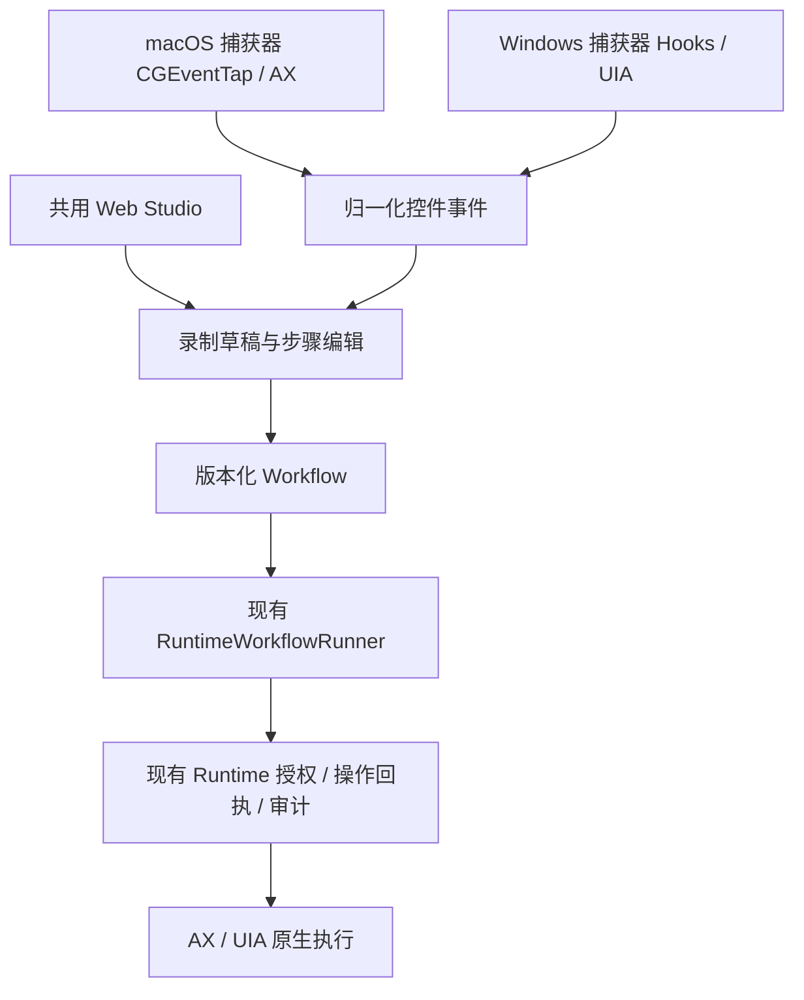

# Shortcuts / Workflow 完善计划与可行性评审

> 历史 r1 方案。当前以[桌面 UX r4](DESKTOP-UX-PLAN.md)为准：桌面宿主承载操作录制与 Workflow 回放。

> 历史草案 r1，已由 [桌面 UX 与录制回放计划](DESKTOP-UX-PLAN.md) 取代。当前采用 Electron 桌面宿主，覆盖设置、对话、录制回放与维护；本机默认直接执行，禁止 Java。下文保留原评审，不再作为实施依据。

日期：2026-10-14。评审源码基线：`89f1564`。状态：计划草案，尚未实施。

本次授权仅为制定、评审和完善计划；不修改功能代码，不开始部署或实机操作。Shortcuts 指操作录制、编辑、保存和回放的 Workflow。当前没有视频录屏或从视频生成步骤；这些不属于本计划的首版目标。原完整业务复测继续保持暂停，本计划将来的专用验收单独记录。

## 1. 决策结论

不整合三套开源产品，也不以采用项目数量作为完成指标。继续使用 Bokkio 的 Python Runtime、现有 Web Studio 和语义 Workflow。

- CrossMacro：作为主要 UX 参考，采用步骤列表与属性面板、撤销/重做、明确录制状态等交互思路，自行实现；不嵌入 Avalonia/.NET 引擎。
- Ui.Vision：按需参考等待/验证表单、步骤调试反馈与编辑/运行两种入口；不引入扩展、XModules 或另一套执行器。断点、变量查看等高级功能后置。
- KeymouseGo：保留作为简单录制控制的对照，不作为组件或依赖。其坐标事件引擎不能直接提供 Bokkio 所需的 UIA/AX 语义与 Runtime 操作回执。
- Repeat、record-and-play-pynput、MouseKeyboardMacroRecorder：不列入首版实施依赖。只有出现明确缺口时再评估具体组件。

允许最终只采用一个项目的交互思路。任何新增依赖必须说明现有组件无法解决的具体问题、收益、许可证、打包与回退办法。

可行性判断：共用界面和受限语义录制回放具备实现基础；Windows 新录制器是待实机证明的关键项。任意桌面软件/画布、通用跨系统原样回放、所有流程后台运行不在可承诺范围。

## 2. 当前事实与差距

| 项目 | 已有事实 | 本计划需补齐 |
|---|---|---|
| 共用界面 | HTML/CSS/JS，由本机 Python HTTP 服务提供 | 可发现入口、平台状态、表单编辑和运行反馈；Windows 打开与操作证据 |
| macOS 录制 | CGEventTap + AXUIElement，字段值读回，生成语义步骤 | 同名目标上下文、短暂控件、录制中断/缺口可见性 |
| Windows 录制 | recorder_helper 明确只允许 macOS | Hook 捕获、UIA 命中/读回、文本归并和资源释放 |
| 回放 | 新 Runtime 重新定位、精确操作 ID、审批/审计/检查点 | Windows 当前版本实机闭环；更清楚的支持范围 |
| 等待/验证 | native 步骤已有 wait/verify | 普通用户表单；动作执行和业务验证分别呈现 |
| 参数/修复 | 旧 Workflow 有相应实现，新 Runtime schema 未接入 | 参数作为后续扩展；先提供人工重新绑定/另存版本 |
| 测试 | macOS UX 汇总和受控输入证据，另有合同测试 | Windows 真正从界面操作；独立结果核验；两平台分母分开 |

主要代码依据：`manual_recording.py`、`native/macos_record.swift`、`app_launch.py`、`workflow_studio.py`、`runtime_workflow.py`、`windows_uia.py`、`tool_schema.py`。现有证明范围见 `WORKFLOW-STUDIO.md` 与 `evidence/2026-10-13-workflow-studio/`。

具体接入差距：ManualRecorder.ingest 当前依赖 ax_role/ax_identifier；Studio 原生控件选取只额外提取 ax_identifier；find_target 对 identifier 先做全窗口唯一性检查。新增 Windows 不能只换输入监听库，需要归一化控件描述，并在窗口/父级上下文中消歧。UIA AutomationId 不能被当作全局唯一身份。

## 3. 首版目标与范围

首版目标：在明确支持的 macOS/Windows 原生控件中，用户能从 Studio 录制操作，审阅并配置验证，保存版本，在同一平台重新定位回放，并看懂成功、失败和待处理原因。

首版包含：

1. 共用 Studio 的启动入口与平台/权限/能力状态。
2. 两平台左键点击、具有可靠原生读回/写入能力的文本字段、选择/切换类控件。
3. 被动捕获：监听不吞掉、不替换、不再次派发用户输入；仅录制授权应用/窗口。
4. 步骤列表、属性表单、重排/复制/删除、撤销/重做、等待与验证配置。
5. 未识别操作逐项标记、补步骤或明确忽略；录制缺口不会默认为完整流程。
6. 通过当前 Runtime 回放，显示步骤、回执、验证结果、审批和中断状态。
7. 失败目标人工重新绑定并保存新版本；运行中的版本继续冻结。

原生滚动列为技术验证后的条件项：能定位滚动容器、读回状态并生成可核验 scroll 步骤才纳入；否则保留为需人工补充的操作。快捷键转菜单命令、拖拽、右键、画布/图像/OCR、网页录制、视频录屏、循环/分支、调度、远程执行、模型自动修复、原样跨系统回放后置。

保留已有网页/代码步骤，不以其替代 Windows 语义录制，也不扩建为新的业务工作流平台。

## 4. 技术方案

### 4.1 继续采用一套界面和一个执行边界

录制监听与执行器分开，录制器没有写入执行职责。UI 不直接调用第三方鼠标回放引擎。录制产生的后台模式支持由实际动作传输判定，不因保存成 JSON 就自动成立。

### 4.2 Windows 捕获器先独立证明

Hook 回调只获取最小事件与时间/顺序信息并快速入队；UIA 查询放在拥有明确 COM 生命周期的工作线程或独立捕获进程，不把 COM 对象跨线程传递。先评估复用现有原生访问边界的时延，再决定捕获进程形态；不能把现有回放线程直接视为可实时捕获的实现。

点击命中尽可能在目标仍存活时获取控件属性，之后补充观察。文本以稳定提交后的字段值归并，验证中文输入法、粘贴、空值和焦点切换；缺乏可靠 ValuePattern/TextPattern 读回或原生写入的编辑区进入待审阅，不用原始按键记录冒充已支持。

两端输出共同的角色、名称、平台标识、父级和窗口上下文；输入时序作为录制诊断信息，执行步骤继续使用条件等待。运行期 PID/HWND/ref 不能作为重启后持久化身份。坐标用于捕获命中与诊断，不成为首版默认回放定位器。

队列必须有上限与丢失检测。监听超时、队列溢出、查询失败、目标消失或捕获进程退出应显示缺口并标记草稿不完整；不能丢事件后继续声称录制完成。

安全字段在读值/持久化前排除；Windows 检查 UIA IsPassword，并验证自绘密码框的不可识别情况。首版不保存原始键盘文本、剪贴板内容或默认截图。普通文本仍可能敏感，应支持排除字段、暂停和审阅删除。

### 4.3 数据和版本演进

先尽量保持当前 v1 可执行步骤。录制缺口/来源信息使用显式版本的草稿元数据，不向严格 v1 schema 塞未声明字段，也不建立第二套回放时间线。

若参数化或必要的平台绑定需要改变持久化合同，再引入新 schema，并提供明确转换。旧已保存版本和运行检查点不原地改写。参数值在运行前冻结，参与运行摘要、资源校验和精确请求；不得通过参数扩大路径/应用授权。

共用 UI 只保证相同编辑和运行体验，不保证同一原生流程跨系统无修改运行。第一版每份原生流程绑定一个录制平台；跨系统模板以后的独立目标绑定验证为准。

## 5. UX 方案

先使用现有 HTML/CSS/JS，不因参考项目而更换为 Qt/Avalonia、引入完整前端框架或增加原生壳。

| 入口 | 内容 | 本轮约束 |
|---|---|---|
| Workflow 库 | 名称、版本、搜索、最近结果，新建/录制/运行 | 安装后有可发现启动入口和明确服务失败信息 |
| 录制 | 应用/窗口选择、能力状态、开始/暂停/停止、事件/步骤数、缺口 | 切换到目标应用后仍有停止途径；首轮优先验证停止热键，小浮窗/托盘按需要后续决定 |
| 编辑 | 左侧步骤，右侧目标/参数/等待/验证属性 | 表单为主，高级 JSON 保留；列表切换不丢未保存内容 |
| 运行 | 冻结版本、当前步骤、等待/审批、动作和验证结果 | 不把执行回执自动等同业务完成，不提供未知结果的一键重发 |
| 修复 | 失败目标、只读候选、人工重新绑定、新版本 | 从头运行也可能重复副作用；首版对已派发失败只解释证据，不自动提供“安全续跑”保证 |

等待和验证的首版表单只覆盖已有合同：控件出现/消失、enabled/checked/selected 等状态、文本值等于。验证可选不同于动作目标的控件；更复杂条件明确进入高级配置。默认 present=true 标成弱验证，不据此宣传业务任务已完成。

撤销/重做只作用于本地编辑草稿；保存产生不可变新版本，不回写旧版本。页面按钮按状态启用，避免暂停/停止/回放并发；运行页明确区分安全边界暂停、取消和待审批。

## 6. 分阶段计划与继续条件

以下均为待执行工作，不是已完成项目。

| 阶段 | 工作及交付物 | 通过条件 | 未通过时 |
|---|---|---|---|
| P0 现状与入口 | 固定基线；在 Windows/Edge、macOS/Chrome 打开当前安装版，核对启动/空库/手工编辑/保存；记录源码、环境和失败 | 两端从明确入口进入实际 UI，管理路径可操作；支持/未支持状态正确 | 修复安装/页面/平台问题，暂不投入高级编辑 |
| P1 Windows 技术验证 | 受控原生 fixture：点击、字段输入、选择，输出语义草稿，经当前 Runtime 回放；验证被动捕获、密码排除、COM/退出生命周期 | 关键链路连续 3 次独立运行通过，字段和计数独立读回正确，无重派发、错目标、泄露或静默缺口 | 定位 Hook、UIA、读回、定位或 Runtime 问题；必要时缩小支持范围并报告，不用坐标宏掩盖失败 |
| P2 两端最小闭环 | 提取共同录制合同，补平台目标上下文/缺口处理/暂停停止；先给 Windows 接入现有 Studio，再同步改进 macOS | 两端经 UI 完成录制→审阅→保存→回放；窗口移动/重启重新绑定通过；不支持操作可解释 | 收敛具体控件类别，不声称跨平台完成 |
| P3 编辑与运行体验 | 步骤/属性分栏、等待验证表单、逐项缺口处理、撤销重做、结构化运行反馈、人工重绑 | 不编辑 JSON 可完成支持范围内流程；保存/版本/授权/操作事实保持一致 | 保留现有可用界面，逐项交付，不做一次性重写 |
| P4 复用扩展（条件项） | 命名参数与运行表单；原生滚动；明确新 schema 或转换路径 | 用户样本确实需要，旧流程可运行，参数变更不越权/不破坏回执冻结 | 留在后续，不阻挡首版录制回放交付 |
| P5 安装与 UX 验收 | checkout 外安装，双平台界面任务、实机边界、报告和支持清单 | 下述验收逐项有证据，未测项单列；用户实际能找到并启动界面 | 不标记 Windows 已交付或全部 UX 已通过 |

P1 是核心投资判断点，P2 成立后才展开 P3。P4 不属于最小首版的必备项；不因已经研究某项目就提前加循环、视觉或调度。

工期为未验证的工程估算：在 Windows 环境可用、安装/权限正常、UIA 控件支持满足的条件下，2–3 个工作日可安排关键链路 PoC；它不是完整产品承诺。P0/P1 后重新估算，最小首版可先按约 2–4 周量级规划，单人连续投入、含双平台专项验证，不含通用画布/视频/客户全面验收。出现 provider 不支持、显示/权限/架构问题时必须调整范围和时间。

## 7. 风险评审与控制

| 风险 | 判断 | 控制和验证 |
|---|---|---|
| 三套技术栈/执行器整合 | 收益未证明、复杂度高 | 只借鉴交互，自行实现；不增加 .NET/Qt/扩展运行时依赖 |
| 许可证及非开源组件 | 直接复用需评估 | 固定来源版本，逐文件核对；当前不复制源代码/素材或捆绑第三方产品；不能以“分进程”自行认定许可问题消失 |
| UIA/AX 信息不足或短暂控件消失 | 高，决定覆盖范围 | P1 用真实 provider 验证，缺口显式可见；同名/重复标识结合上下文，歧义不猜测 |
| 输入捕获时序/队列/COM | 高，可能漏录/卡顿 | 轻量回调、有界队列、单线程拥有 COM；中文提交/快速切换/进程退出专项 |
| 录制输入不等于语义写入 | 高，set_value 可能不触发同样提交效果 | 读回以外验证业务结果，要求显式提交步骤；不支持的编辑区留待审阅 |
| 误报完成 | 高，present 不是业务验证 | 明确验证强度；成功依据独立结果，而非播放器走到最后或页面显示 completed |
| 已派发失败/未知完成后的修复 | 高，重复发送/保存等副作用 | 保留 exact operation 回执和 unknown 停止；修复新版本不自动意味着能接续旧运行 |
| 密码及普通敏感文本 | 高 | 读值前过滤、字段排除、暂停、审阅/删除；报告脱敏，私有原始证据不进 Git |
| 后台执行与前台输入混淆 | 高 | 第一轮 Windows 默认验证有头；后台单列实机成绩，不能由捕获通过推断 |
| DPI/多屏/架构/应用权限 | 中高 | 目标环境明确架构；100%/150% 缩放与布局变化分别测，不以 VM 推断全部物理环境 |
| schema/参数/授权演进 | 中高 | 旧版本不改写，新版本合同明确；运行前冻结参数与资源，重复调用仍回读同一操作 |
| UI 跨平台但数据不可迁移 | 中 | 支持清单区分界面、捕获、动作和流程平台；不宣传原样跨系统回放 |
| 首版范围膨胀 | 高 | 不加入完整 DAG、循环、模型修复、远程执行和视频；按真实样本需求选择后续项 |

许可证事实：CrossMacro 为 GPL-3.0-only（项目 README），KeymouseGo 包含 GPLv2 许可证，Ui.Vision 为 AGPLv3/商业双许可，Repeat 为 Apache-2.0。Bokkio 当前项目元数据未声明项目 license；直接复用前还须明确自身分发方式。以上是采用决策输入，不是对组合分发许可的法律结论。

## 8. 验收方案：证明用户能操作，而不是只有接口能调用

### 8.1 三类证据独立记录

- 合同测试：schema、版本冲突、作用域、操作去重、审批、未知完成等。
- 捕获/执行实机测试：真实 Hook/AX/UIA、输入法、窗口移动、重绑、暂停与退出。
- UX 测试：从浏览器界面点击控件完成流程，保存按钮/步骤/版本/运行状态确实生效。评分依赖独立原生读回或结果文件，不用 UI 自报结果评分。

用脚本调用 Studio API 不能算界面操作测试；生成 OS 输入不能标为用户本人演示；macOS 通过不能填进 Windows 分母。每项记录运行时源码/包哈希、OS/架构/浏览器、目标应用版本和样本，保留失败与阻塞，不覆盖旧结果。

### 8.2 最小固定矩阵

1. 两端管理路径：启动、空库、新建、录制、暂停/恢复、停止、审阅/编辑、保存、切换版本、重新打开 Studio、回放、取消/审批、查看失败、归档。
2. P1 fixture 链路：同一明确支持的完整操作，每端 3 次；独立字段值与提交次数核验。
3. 两端各选至少两个实际目标应用、共三个低风险任务，每任务 3 次。P0/P1 后冻结具体任务、初始状态、结果评分和允许手工补充范围；这是一份新专用 suite，不恢复旧完整业务矩阵。
4. 变化/负向测试：窗口移动；应用关闭后启动及新 PID；同名/重复 identifier；缺失/禁用控件；动态窗口标题；权限不足；监听器退出/队列溢出；暂停期间输入；安全字段；IME/粘贴；未识别快捷键/右键/拖拽；旧版本与编辑冲突。
5. Windows 100%/150% DPI 与一次多屏场景分别验证；无对应硬件则标未测，不用代码中的合成坐标当作物理验收。后台模式单独验证前台 PID/鼠标不被改变。
6. 发布包在 checkout 外启动并通过上述适用管理/闭环路径；至少一次用户本人演示与反馈，若未发生则单列未完成。

支持范围内的确定性验收项应全部通过；安全/事实项要求零错目标、零未授权派发、零未知结果自动重发、零已识别密码值持久化。实际应用稳定性每任务须达到 3/3；达不到则记录任务失败和支持限制。缩小范围必须形成新 suite 版本，不能把失败从原分母删除。

### 8.3 修复和继续的事实边界

等待超时或定位失败且确认零派发，可以经过新观察/新审批进行新的尝试。动作已执行但验证失败，只能先检查结果；unknown 不自动重发。人工重绑和另存版本是编辑能力，安全续跑需要单独的运行迁移、状态前沿和验证合同，后续评估，首版不承诺。

## 9. 可行性结论与下一决策

明确可推进：共用 Web Studio、步骤编辑、已有条件表单、版本和结构化运行反馈。

有条件可推进：Windows 语义录制，必须通过 P1；滚动和参数只有样本收益/合同验证成立才进入首版扩展；后台 Windows 另行验收。

本轮不合理：把 CrossMacro、KeymouseGo、Ui.Vision 或 Repeat 的完整引擎拼接进 Runtime。它们的格式、身份、输入传输和执行事实不统一，转换与验证成本很可能高于补齐现有实现。当前没有基准证明外部引擎能提高 Bokkio 的端到端稳定性。

下一实施顺序为 P0 → P1 → P2 → P3 → P5；P4 按证据决定。只有上述专用验收成立才称 Windows Shortcuts 可用；不从界面源码存在推导双平台产品完成。

## 10. 外部参考（2026-10-14 核对）

- [CrossMacro 功能/编辑 UX](https://github.com/alper-han/CrossMacro/blob/dev/docs/features.md)、[Avalonia UI 工程](https://github.com/alper-han/CrossMacro/blob/dev/src/CrossMacro.UI/CrossMacro.UI.csproj)、[许可证](https://github.com/alper-han/CrossMacro/blob/dev/LICENSE)。
- [KeymouseGo 使用说明](https://github.com/taojy123/KeymouseGo)、[PySide6 界面](https://github.com/taojy123/KeymouseGo/blob/master/UIView.py)、[许可证](https://github.com/taojy123/KeymouseGo/blob/master/LICENSE)。
- [Ui.Vision 编辑/命令手册](https://ui.vision/rpa/docs/)、[编辑器与回放侧栏](https://ui.vision/rpa/docs/sidepanel)、[双许可说明](https://github.com/A9T9/RPA/blob/master/LICENSE.txt)。
- [Repeat 本机 Web UI 与任务管理](https://github.com/repeats/Repeat/wiki/Getting-started)、[许可证](https://github.com/repeats/Repeat/blob/master/LICENSE)。

核查依据是官方文档、源码和仓库截图；未安装这些产品逐一实测。参考的交互功能不计入 Bokkio 已交付能力。
