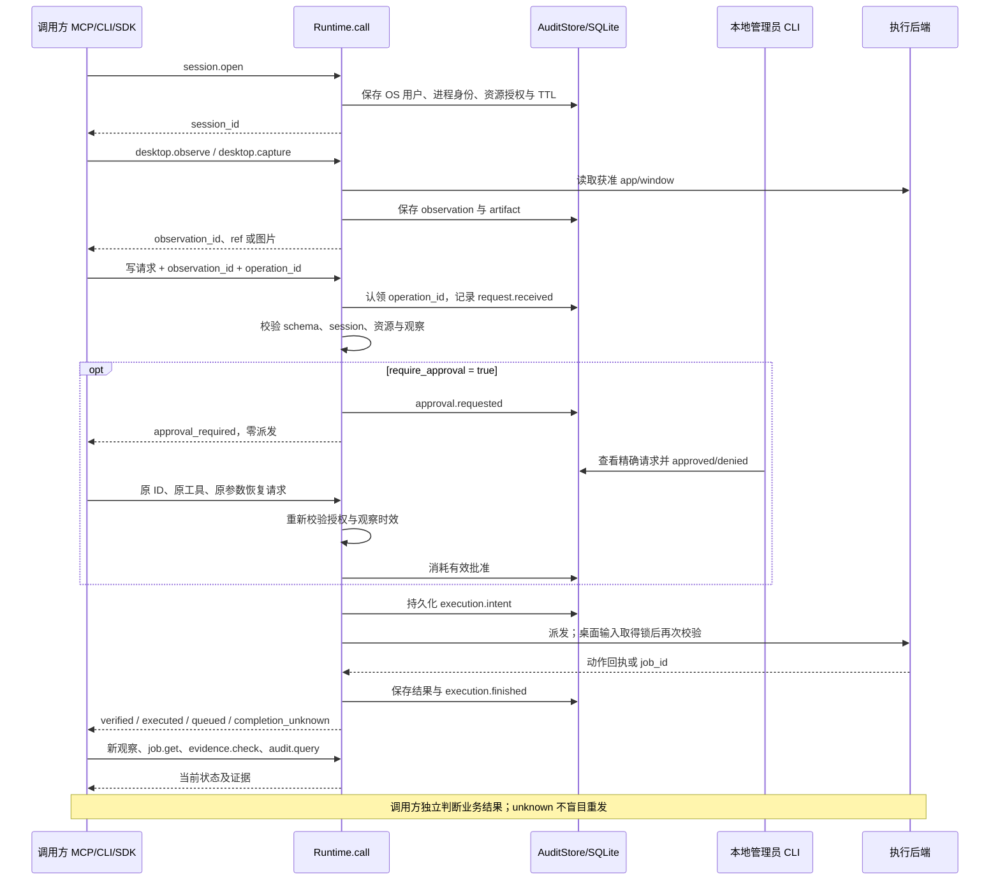

# Runtime 操作生命周期与证据合同

本页适用于 0.2.0 的 Runtime.call 路径；旧 Agent/Workflow 的 backend 动作与 trace 应按旧接口单独解释。^[docs/RUNTIME-GUIDE.md#L3]

## 观察 → 审批 → 派发 → 独立核验

时序中的审批分支仅在有效批准后继续派发；拒绝/过期返回 denied，过期观察需新观察和新请求。code/process 派发是队列提交，worker 后续记录实际脚本启动/完成；新观察、job.get 与 evidence.check 由调用方按通道选择。^[src/bokkio/runtime.py#L235] ^[src/bokkio/executor.py#L188]

## 身份、时效与恢复

| 标识 / 约束 | 合同 |
|---|---|
| session_id | 当前 OS 用户、open、未过期；限定 apps/windows/paths/origins |
| observation_id | 同会话、同 app/window、匹配 native/pixel 类型，最多 15 秒 |
| ref / snapshot_sha256 | 当前结构身份与完整观察摘要；派发前重新读取并核验 |
| operation_id | 全工具/参数/session 请求哈希绑定；改参数不能复用 ID |
| approval_id | 300 秒有效申请、精确请求绑定、批准后 consumed；不延长 observation |
| job_id | 会话范围、持久状态；查询核对 worker 和子进程出生身份 |
| artifact_id | 会话范围、大小预算、注册时字节 SHA-256；文件变化拒绝读取 |
| parent_operation | 生成代码的 SDK 子操作关联父操作；每个写子操作仍需自己的审批 |

依据：^[src/bokkio/runtime.py#L181] ^[src/bokkio/runtime.py#L242] ^[src/bokkio/runtime.py#L161] ^[src/bokkio/executor.py#L187]

批准后用原 operation_id/原工具/原参数恢复。完成请求重复调用记录 request.cached 并返回缓存，不新派发；会话关闭/过期/换用户不能靠缓存绕过读取边界。已认领但缺少持久结果时返回 completion_unknown，先检查 UI/文件/审计。^[src/bokkio/runtime.py#L201] ^[src/bokkio/runtime.py#L212]

## 执行状态和业务结果

- `approval_required`：待审批，零派发；`denied`：校验/授权/审批拒绝。
- `completed`：读/管理工具完成；`job.get` 的外层 completed 表示查询成功，须继续读取内部 job 状态。
- `verified`：动作 verification=confirmed；编辑控件属性确认仍可能未提交到业务模型。
- `executed`：写操作已执行但未证明业务完成；`queued`：作业已入队，尚需核对真实启动与终态。
- `failed`：当前操作失败；若可能有副作用或缺回执，保守返回 `completion_unknown`，不得盲重发。
- `job.get.result.status`：queued/running/completed/failed/cancelled/timed_out/completion_unknown；即使 completed，也要验收交付内容。

依据：^[src/bokkio/runtime.py#L272] ^[src/bokkio/runtime.py#L278] ^[docs/progress/STATUS.md#L29]

派发前 execution.intent 不能持久化则拒绝；派发后结果不能持久化保持未知。worker_lost 会清理仍可确认身份的跟踪子进程并记录 unknown，不自动重放。审计/CSV/哈希只能证明对应事实，调用方负责语义正确性、保存和新进程重开等业务条件。^[src/bokkio/runtime.py#L300] ^[src/bokkio/executor.py#L101]

关联：[[entities/runtime-core]]、[[summaries/module-call-map]]、[[concepts/action-verification]]、[[concepts/element-identity]]、[[concepts/evidence-and-scoring]]。
