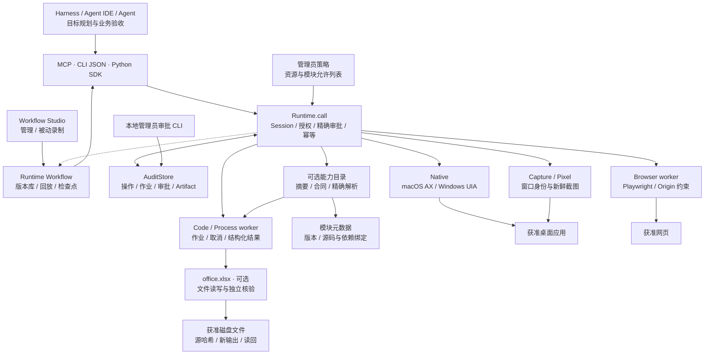
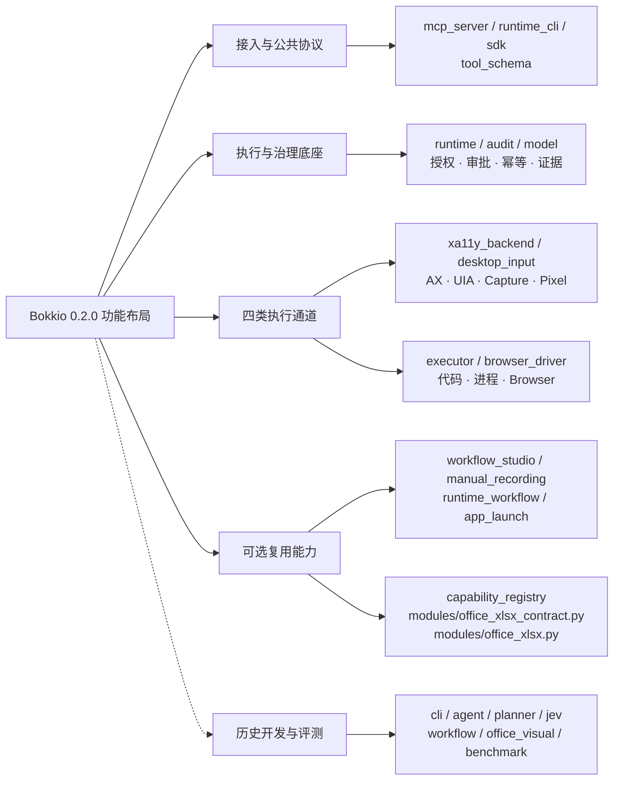

# 架构与代码导航

截至2026-10-13，工作候选版0.2.0是模型无关的 Computer Use Runtime。外部 Harness 负责目标／子任务规划、通道选择和最终业务验收；Core 不调用 Planner/Jev。^[src/bokkio/runtime.py#L1]

## 当前系统图

MCP、CLI、SDK共享 Runtime.call、输入合同、会话、精确审批和审计。Studio的回放通过SDK调用同一Core；workflow.*启动Runner，后续每个子动作仍通过Core。^[src/bokkio/runtime.py#L405] ^[src/bokkio/runtime_workflow.py#L161]

## 功能模块布局

布局箭头表示功能归属；具体调用见 [[summaries/module-call-map]]。能力分类是标签，当前只有一个静态注册的默认关闭office.xlsx模块；能力发现只读元数据，精确调用解析合同后进入已有代码作业。它不操作打开的Excel文档。^[src/bokkio/capability_registry.py#L29] ^[src/bokkio/runtime.py#L391]

## 运行与治理边界

- 管理员策略与Session资源授权、精确审批、operation ID和持久审计在Core统一执行。模块调用额外检查modules允许列表、版本、合同SHA256、实现源码及实际依赖版本。^[src/bokkio/runtime.py#L183] ^[src/bokkio/capability_registry.py#L55]
- 原生backend在单一专用线程运行；原生动作、像素和Browser派发共享桌面锁，等待后重验范围。代码／模块和Browser各有独立worker。^[src/bokkio/runtime.py#L94] ^[src/bokkio/desktop_input.py#L61]
- RuntimeWorkflow保存JSON版本与精确子操作检查点；未知完成不重发。后台桌面需未锁定交互会话，且仅允许支持的原生传输。^[src/bokkio/runtime_workflow.py#L133] ^[docs/WORKFLOW-STUDIO.md#L73]
- capability.invoke复用executor；缺失结果证据或合同绑定不符保持unknown。office extra不是Core依赖，发现不会导入openpyxl。^[src/bokkio/executor.py#L238] ^[pyproject.toml#L17]

## 历史扩展与验收

旧 cli/agent/planner/jev/workflow/office_visual 仍直接调用传入backend；它们与新的Runtime Workflow、文件能力模块有不同入口和边界。历史专题保留当时的证据。^[docs/RUNTIME-GUIDE.md#L3]

最新隔离回归647/647、受控文件对照6/6；完整自主业务矩阵暂停，旧26/36、17/27、GUI0/18保留原冻结版本范围。客户／Windows仍待验收，trusted-host不是OS沙箱。^[docs/progress/STATUS.md#L13]

关联：[[entities/runtime-core]]、[[entities/capability-modules]]、[[entities/runtime-workflow]]、[[summaries/current-status]]、[[summaries/pending-and-known-gaps]]。
