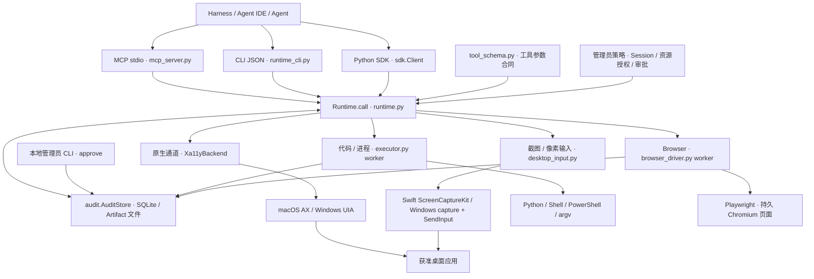
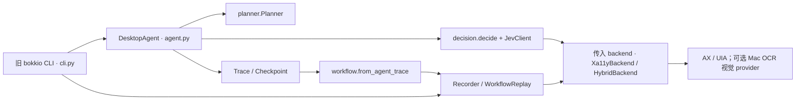

# 架构与代码导航

截至 2026-10-13，工作候选版 0.2.0 的主架构是模型无关的通用 Computer Use Runtime。Harness、Agent IDE 或 Agent 选择工具并验收业务；Core 不调用 Planner/Jev，也不内置客户应用业务流程。^[src/bokkio/runtime.py#L1] ^[docs/RUNTIME-GUIDE.md#L3]

## 设计分层与系统图

三种入口调用同一 `Runtime.call()`，共享工具名、参数合同、Session、审批与审计；SDK 是进程内客户端，CLI/MCP 通过相同私有状态目录保存跨进程记录。MCP envelope 的 `arguments`、`session_id`、`operation_id` 同级，图片 artifact 通过 `ImageContent` 返回。^[src/bokkio/mcp_server.py#L31] ^[src/bokkio/sdk.py#L30] ^[src/bokkio/runtime_cli.py#L60]

## 核心设计选择

| 选择 | 当前实现与目的 |
|---|---|
| 模型与执行分离 | 调用方规划/决策；Core 接收具体工具参数，使不同 Harness 可组合同一能力 |
| 默认拒绝与会话绑定 | 管理员策略定义 apps/windows/paths/origins；Session 绑定 OS 用户、进程创建身份和 TTL，应用重启须新开会话 |
| 观察绑定动作 | 原生动作关联 snapshot/ref；像素动作关联 PNG/窗口几何/进程身份；观察最多 15 秒，派发前重验 |
| 审批与幂等 | 写请求可先返回 approval_required；批准绑定精确请求哈希，同一 operation_id 不再次派发已记录操作 |
| 后端通道分工 | 原生 AX/UIA、窗口像素、trusted-host 代码/进程、持久 Browser；Core 不自动选择降级通道 |
| 持久证据 | SQLite 保存操作、审批、事件、观察与作业；私有文件存 PNG/完整 snapshot/输出，artifact 校验哈希 |
| 保守处理未知 | 已进入派发而缺少可靠回执时返回 completion_unknown；worker 丢失需查证，不自动重跑 |

依据：^[src/bokkio/runtime.py#L104] ^[src/bokkio/runtime.py#L155] ^[src/bokkio/runtime.py#L178] ^[src/bokkio/executor.py#L79]

## 部署、线程和进程边界

- 本地 Python 包；`bokkio-runtime serve` 启动官方 MCP stdio server。Core ≥Python 3.9，MCP ≥3.10；Playwright 为 Browser extra，Mac 包内原生 helper 使用 Swift。^[pyproject.toml#L9]
- 每个 Runtime 的 Native backend 延迟创建，统一由单线程 `_native_executor` 访问，避免 AX 可变句柄表/Windows COM apartment 被并发操作。^[src/bokkio/runtime.py#L74]
- 原生动作、激活、像素和 Browser 请求共用同 OS 用户的跨进程桌面锁；锁等待后再次验证会话/授权/观察。锁不把任意宿主脚本变成受控 GUI 客户端。^[src/bokkio/desktop_input.py#L61] ^[src/bokkio/runtime.py#L165]
- `executor.launch` 启动独立 Python worker，再派发脚本/argv 子进程；stdout/stderr 持续排空并限量保存，取消/超时终止可跟踪进程树。生成 Python 可经 SDK 回到同一会话，带父操作 ID；子动作仍独立审批。^[src/bokkio/executor.py#L59] ^[src/bokkio/executor.py#L187]
- Browser 为每会话持久 Chromium worker，Core 经 loopback HTTP/token 调用；页面跨 CLI/SDK 调用保留，session 关闭/过期后退出。精确 origin 限制请求/WebSocket，动作还检查 expected_url。^[src/bokkio/browser_driver.py#L24] ^[src/bokkio/browser_driver.py#L57]

## 旧 Agent / Workflow 的位置

旧 Agent、Jev 决策和 Workflow 通过传入 backend 的 snapshot/perform 运行，当前没有适配成 `Runtime.call` 客户端。因此“Workflow 重放调用 Runtime”的旧文档指 backend，不能理解为已进入 0.2.0 Core 的 Session/审批/审计边界。`HybridBackend` 的 Mac 文字视觉降级已实现，是旧扩展的 opt-in 路径；新 Core 的像素工具不依赖它。^[src/bokkio/agent.py#L505] ^[src/bokkio/workflow.py#L242] ^[src/bokkio/visual_runtime.py#L158]

## 能力与验收边界

当前 Python/Swift/xa11y 实现不等于 Rust Runtime 或完整 CUP 协议适配。trusted-host 脚本的 cwd 检查不是 OS 沙箱，SQLite 不是防篡改集中审计服务；远程 fleet、多租户 SSO、签名安装器和离线镜像未交付。Mac 开发验收与 Windows 新 Runtime/客户环境验收分别记录。^[docs/progress/STATUS.md#L41]

详细调用关系：[[summaries/module-call-map]]；契约与时序：[[concepts/runtime-contracts]]；Core：[[entities/runtime-core]]；原生实现：[[entities/native-runtime]]；当前证据：[[summaries/current-status]]；剩余工作：[[summaries/pending-and-known-gaps]]。
