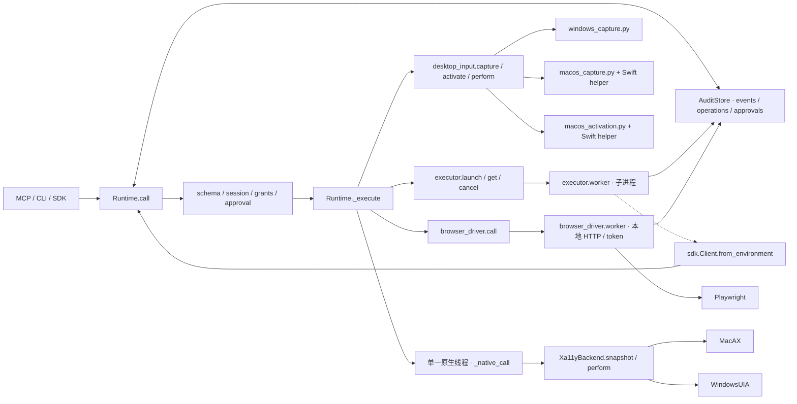

# 模块调用关系与完整代码地图

本页依据 2026-10-13 工作树和提交基线核对；箭头表示实际调用/委派，跨进程边界显式标注。新 Core 与旧扩展分开阅读。^[src/bokkio/runtime.py#L368]

## 当前 Core 模块调用图

## 工具到实现的路由

| 工具 | 实际调用链 | 状态/证据 |
|---|---|---|
| capabilities / session.open / session.close | 入口 → Runtime.call → _execute → AuditStore；开原生会话时调用 backend.apps 和 process_birth | 能力描述、授权绑定、会话状态 |
| desktop.list | _execute → scope.bindings | 仅返回会话绑定应用 |
| desktop.observe | _native_call → Xa11yBackend.snapshot → xa11y + 平台补充 → _observation / _artifact | 有界 nodes、完整 snapshot artifact、observation_id |
| desktop.act | _get_observation → desktop_lock → _dispatch_scope → _native_call(perform) → Xa11yBackend.perform | snapshot digest、ref、读回与 verification |
| desktop.activate | desktop_lock → _dispatch_scope → desktop_input.activate → Mac helper / Win32 | 精确窗口激活回执 |
| desktop.capture | desktop_input.capture → 平台 capture_window → PNG → _artifact / _observation | 带身份/几何/时间的截图观察 |
| desktop.pixel | _get_observation → desktop_lock → _dispatch_scope → desktop_input.perform → Swift input / SendInput | 坐标输入派发回执，业务结果需新观察 |
| code.run / process.run | executor.launch → 新 Python worker → executor.worker → 脚本/argv 子进程 | queued + job_id；最终作业状态/输出 |
| job.get / job.cancel | executor.get / cancel → SQLite；get 会核对 worker 身份并处理 worker_lost | job 终态；查询可能清理已丢失 worker 的子进程 |
| browser.open / observe / act | desktop_lock → _dispatch_scope → browser_driver.call → loopback HTTP/token → worker → Playwright | 持久页面、URL、正文/字段；动作要求唯一 selector |
| evidence.check / artifact.read | Runtime 文件/会话/预算检查 → 哈希/CSV 核验或读取 → artifact | 文件事实；MCP 图片使用 ImageContent |
| audit.query / audit.export / events.follow / metrics.summary / approval.status | Runtime → AuditStore.query / export / stats / approvals | 会话范围事件、统计、审批、导出 artifact |

路由依据：^[src/bokkio/runtime.py#L368] ^[src/bokkio/mcp_server.py#L39] ^[src/bokkio/executor.py#L79]

## 新 Core 文件地图

以下路径均相对仓库根目录；`src/bokkio/` 为模块目录。

| 模块 | 直接协作 / 主要责任 |
|---|---|
| runtime_cli.py | Runtime + AuditStore；call/serve 走 Core，approve/管理员日志命令直接访问本地 store |
| mcp_server.py | Runtime + tool_schema；官方 MCP SDK stdio 工具发现、调用、结构化结果与图片 |
| sdk.py | Runtime + AuditStore；普通客户端或 from_environment 委派会话，wait_job 轮询 |
| runtime.py | tool_schema、audit、model、selector、xa11y_backend、desktop_input、executor、browser_driver；统一边界与分派 |
| tool_schema.py | schema、工具说明、输入校验；由 MCP 与 Core 共用 |
| audit.py | SQLite、文件、OS identity；会话/操作/审批/事件/产物与摘要导出、统计 |
| executor.py | AuditStore + runtime.process_birth；worker/子进程生命周期、输出/超时/取消与父子操作关联 |
| browser_driver.py | AuditStore + Playwright；每会话本地 HTTP worker、origin/URL/selector 验证 |
| desktop_input.py | capture/activation + 平台输入；跨进程锁、输入会话检查、图像身份和坐标 |
| xa11y_backend.py | xa11y、model、selector、scroll、WindowsUIA / MacAX；统一树、ref、能力和动作读回 |
| model.py | 通用错误、RefResolver、stable_hash、tree_digest、元素规范化；为原生/决策/视觉等共享 |
| selector.py | 树 flatten / 语义查找 / ref 解析；调用方无需持有 OS 对象指针 |
| scroll.py | model + selector；滚动计划和位置/内容观察 |
| windows_uia.py | comtypes UIA + Win32；Value/Scroll/Selection/Invoke 等补充及经典字段提交 |
| macos_ax.py | ctypes AX/CoreFoundation + model/selector；能力/属性/菜单补充及有界动作 |
| windows_capture.py | Win32/DPI/GDI；窗口身份、客户区 PNG 与 CaptureError |
| macos_capture.py | native/macos_capture.swift 编译/调用；窗口 PNG、几何、时间和可选 Vision OCR |
| macos_activation.py | native/macos_activate.swift；精确窗口前台/进程身份检查 |
| native/macos_capture.swift | ScreenCaptureKit / Vision / 原生事件；capture/OCR/受约束输入 helper |
| native/macos_activate.swift | NSRunningApplication / AX；激活并核验目标窗口 |

入口和公共支持依据：^[pyproject.toml#L12] ^[src/bokkio/xa11y_backend.py#L55] ^[src/bokkio/desktop_input.py#L93]

## 旧扩展、业务适配与评测地图

| 模块 / 目录 | 直接协作 / 主要责任 |
|---|---|
| __init__.py / __main__.py | 包导出 model 基础类型；python -m bokkio 转入旧 cli.main |
| cli.py | 原生直接命令、capture/decide/run/workflow；创建 backend 与可选 Agent/视觉适配，不经过新 Core |
| agent.py | Planner + decision/Jev + backend；观察、阶段规划、执行、成功条件、trace、暂停恢复 |
| planner.py | 模型 API、计划结构与本地成功条件校验；提供方配置只属于可选扩展 |
| jev.py | JevClient 调用提供方 Decisions API；由 decision.decide 使用 |
| decision.py | model/selector + DecisionProvider；闭集动作/目标、置信度检查；execute_decision → backend.perform |
| workflow.py | backend + agent/planner 条件 + workflow_inputs；Recorder、trace 编译、确定性重放、版本和恢复 |
| workflow_inputs.py | 参数/输入与交付文件版本、路径/哈希合同；被 Workflow 使用 |
| workflow_repair.py | Planner/provider 配置与候选选择；修复失败 selector 生成新版本，正常 replay 不调用模型 |
| visual.py | capture 元数据验证、OCR 文本候选与图像/屏幕坐标换算 |
| visual_input.py | 限定 Mac OCR 目标输入 API，capture/native helper 与验证；旧文字视觉路径 |
| visual_runtime.py | VisualProvider / MacVisionProvider / HybridBackend；合并 OCR 节点、预算、明确范围与 opt-in 文字降级 |
| office_visual.py | Office 专用视觉/原生适配；结合 HybridBackend、原生控件和限定输入，不属于 Core 通用规则 |
| arena.py | WAA 逐步动作适配；agent_factory 创建 Agent，runner.step 门控 backend 派发；评测器由 scripts 接入 |
| office_benchmark.py | Office 原题 bundle、工作区准备与独立产物评分 |
| office_runner.py | office_benchmark + DesktopAgent/Office backend；启动、执行和逐题结果记录 |
| office_judge.py | office_benchmark + 可选外部 VLM；保留 judge 入口，是否实测以报告为准 |
| scripts/verify_runtime*.py、verify_harness_clients.py | 新 Runtime 开发验证；业务样本使用独立产物/日志检查 |
| scripts/evaluate_runtime_business.py、evaluate_approval_wait.py | 调用方自主业务与等待恢复评测；评分不是 Core 内置规划 |
| tests/、fixtures/、examples/ | 隔离合同测试、可丢弃原生/视觉/Browser fixture、MCP/SDK/策略示例 |

旧链路依据：^[src/bokkio/cli.py#L160] ^[src/bokkio/agent.py#L361] ^[src/bokkio/decision.py#L562] ^[src/bokkio/workflow.py#L334] ^[src/bokkio/office_runner.py#L233]

可选模块仍有各自 trace/控制规则；它们直接调用 backend 的事实不等于自动具备新 Core 会话/审批保护。新增客户端应选择 MCP/SDK/CLI 契约，独立验收结果，避免把业务规则加入 Core。^[docs/RUNTIME-GUIDE.md#L3]

关联：[[summaries/architecture-map]]、[[entities/runtime-core]]、[[concepts/runtime-contracts]]、[[entities/native-runtime]]、[[entities/workflow-engine]]、[[entities/desktop-agent]]。
