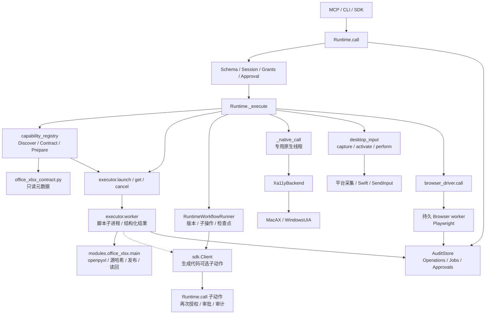

# 模块调用关系与完整代码地图

本页描述当前工作树的调用与文件地图；功能分组见 [[summaries/architecture-map]]，新旧Workflow分别列出。^[src/bokkio/runtime.py#L390]

## 模块调用图

## 工具路由

| 工具 | 实际调用链 | 结果与证据 |
|---|---|---|
| capabilities / session.open / session.close | Runtime → 能力描述／AuditStore；应用绑定使用backend.apps与process_birth | 能力入口、授权Session |
| module.list / capability.list / capability.get | Runtime → capability_registry → office_xlsx_contract | 摘要、健康、完整合同与SHA256；无实现导入 |
| capability.invoke | Runtime校验／审批 → registry.prepare → executor.launch → worker → office_xlsx.main | queued；job.get.result.output含模块核验与文件证据 |
| workflow.list / workflow.get | Runtime → WorkflowLibrary | 获准版本库 |
| workflow.run / workflow.resume / workflow.status / workflow.cancel | Runtime → RuntimeWorkflowRunner → sdk.Client.call → Core子操作 | run_id、检查点、审批、步骤回执 |
| desktop.list / desktop.launch | Session bindings／app_launch → 精确安装身份 → 新PID绑定 | 获准应用和启动回执 |
| desktop.observe / desktop.act | _native_call → Xa11yBackend → MacAX／WindowsUIA | 有界树、observation_id、ref、后置读回；明确拒绝带零派发事实 |
| desktop.capture / desktop.activate / desktop.pixel | desktop_input → 平台采集／激活／输入 | 身份、几何、新鲜截图绑定 |
| code.run / process.run | executor.launch → 独立worker／脚本子进程 | queued、作业输出、取消与超时 |
| job.get / job.cancel | executor → SQLite／worker身份核对 | 终态、worker_lost、未知完成不重放 |
| browser.open / observe / act | 桌面锁 → browser_driver → 持久worker → Playwright | 精确Origin、URL、selector |
| evidence.check / artifact.read | Runtime → 文件范围／哈希／CSV或artifact读取 | 文件事实／MCP图片 |
| audit.query / audit.export / events.follow / metrics.summary / approval.status | Runtime → AuditStore | Session范围日志、审批、查询统计 |

依据：^[src/bokkio/runtime.py#L390] ^[src/bokkio/mcp_server.py#L19] ^[src/bokkio/executor.py#L148]

## 当前代码文件布局

| 文件（相对src/bokkio） | 协作／职责 |
|---|---|
| mcp_server.py / runtime_cli.py / sdk.py / tool_schema.py | 三入口和公共参数合同 |
| runtime.py / audit.py | 会话、授权、精确审批、幂等、分派、SQLite与证据 |
| capability_registry.py | 静态注册、渐进发现、健康、合同绑定和作业准备 |
| modules/__init__.py / modules/office_xlsx_contract.py / modules/office_xlsx.py | 可选模块包、只读元数据、openpyxl文件实现与独立核验 |
| workflow_studio.py / studio/app.js / studio/index.html / studio/studio.css | 本机管理UX／版本／运行记录 |
| manual_recording.py / native/macos_record.swift | 被动录制与文本读回，未识别手势待审阅 |
| runtime_workflow.py / app_launch.py | JSON版本库、精确启动／PID重绑、子操作与检查点 |
| executor.py / browser_driver.py | 代码／进程及Browser worker、作业生命周期 |
| desktop_input.py | 桌面锁、截图／激活／像素输入 |
| xa11y_backend.py / macos_ax.py / windows_uia.py | 原生树、能力与动作传输 |
| model.py / selector.py / scroll.py | 通用错误与派发事实、元素身份、查找和滚动 |
| windows_capture.py / macos_capture.py / macos_activation.py | 平台采集与激活 |
| native/macos_capture.swift / native/macos_activate.swift | Mac原生助手 |

依据：^[src/bokkio/capability_registry.py#L55] ^[src/bokkio/runtime_workflow.py#L133] ^[src/bokkio/model.py#L31]

## 旧扩展、业务适配与评测地图

| 模块 / 目录 | 直接协作 / 主要责任 |
|---|---|
| __init__.py / __main__.py | 包导出 model 基础类型；python -m bokkio 转入旧 cli.main |
| cli.py | 原生直接命令、capture/decide/run/workflow；创建 backend 与可选 Agent/视觉适配，不经过新 Core |
| agent.py | Planner + decision/Jev + backend；观察、阶段规划、执行、成功条件、trace、暂停恢复 |
| planner.py | 模型 API、计划结构与本地成功条件校验；提供方配置只属于可选扩展 |
| jev.py | JevClient 调用提供方 Decisions API；由 decision.decide 使用 |
| decision.py | model/selector + DecisionProvider；闭集动作/目标、置信度检查；execute_decision → backend.perform |
| workflow.py | backend + agent/planner 条件 + workflow_inputs；Recorder、trace 编译、确定性重放、版本和恢复 |
| workflow_inputs.py | 参数/输入与交付文件版本、路径/哈希合同；被 Workflow 使用 |
| workflow_repair.py | Planner/provider 配置与候选选择；修复失败 selector 生成新版本，正常 replay 不调用模型 |
| visual.py | capture 元数据验证、OCR 文本候选与图像/屏幕坐标换算 |
| visual_input.py | 限定 Mac OCR 目标输入 API，capture/native helper 与验证；旧文字视觉路径 |
| visual_runtime.py | VisualProvider / MacVisionProvider / HybridBackend；合并 OCR 节点、预算、明确范围与 opt-in 文字降级 |
| office_visual.py | Office 专用视觉/原生适配；结合 HybridBackend、原生控件和限定输入，不属于 Core 通用规则 |
| arena.py | WAA 逐步动作适配；agent_factory 创建 Agent，runner.step 门控 backend 派发；评测器由 scripts 接入 |
| office_benchmark.py | Office 原题 bundle、工作区准备与独立产物评分 |
| office_runner.py | office_benchmark + DesktopAgent/Office backend；启动、执行和逐题结果记录 |
| office_judge.py | office_benchmark + 可选外部 VLM；保留 judge 入口，是否实测以报告为准 |
| scripts/verify_runtime*.py、verify_harness_clients.py | 新 Runtime 开发验证；业务样本使用独立产物/日志检查 |
| scripts/evaluate_runtime_business.py、evaluate_approval_wait.py | 调用方自主业务与等待恢复评测；评分不是 Core 内置规划 |
| tests/、fixtures/、examples/ | 隔离合同测试、可丢弃原生/视觉/Browser fixture、MCP/SDK/策略示例 |

旧链路依据：^[src/bokkio/cli.py#L160] ^[src/bokkio/agent.py#L361] ^[src/bokkio/decision.py#L562] ^[src/bokkio/workflow.py#L334] ^[src/bokkio/office_runner.py#L233]

可选模块仍有各自 trace/控制规则；它们直接调用 backend 的事实不等于自动具备新 Core 会话/审批保护。新增客户端应选择 MCP/SDK/CLI 契约，独立验收结果，避免把业务规则加入 Core。^[docs/RUNTIME-GUIDE.md#L3]

关联：[[summaries/architecture-map]]、[[entities/runtime-core]]、[[concepts/runtime-contracts]]、[[entities/native-runtime]]、[[entities/workflow-engine]]、[[entities/desktop-agent]]。
